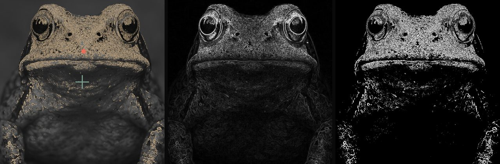

# Visual Thinking Lens

**Image models generate endless subjects. They keep reusing the same structure.**

VTL is a small, deterministic instrument that measures the *geometry* of an image: where its visual mass sits, how that mass spreads, and whether a generator (or an artist) ever leaves its defaults. It never looks at what the image depicts. There's no model in the loop: the same image always gives the same numbers.



<sub>Left: measured mass (gold), frame center (cross), mass centroid (dot). Middle: gradient field. Right: mass mask.</sub>

**[Try it in your browser →](https://parallaxmetrology.github.io/visual-thinking-lens/)** Drop in a few images and see where their mass lands. Nothing is uploaded.

---

## Install

```bash
pip install git+https://github.com/parallaxmetrology/visual-thinking-lens
```

## Use

```python
import vtl

k = vtl.measure("image.jpg")
k["delta_x"], k["delta_y"], k["sdi"]        # where mass sits, how far it spreads

df = vtl.measure_many("my_engine_outputs/")  # one row per image
vtl.fingerprint(df)                          # how the set occupies structural space
```

From a terminal:

```bash
vtl measure image.jpg                         # JSON for one image
vtl measure folder/ -o out.csv --color        # CSV for many, with the color kernel
vtl fingerprint out.csv                       # operating window, walls, spread
vtl compare engine_a.csv engine_b.csv         # two makers side by side
vtl overlay image.jpg                         # the picture above, for your image
```

Prefer notebooks? See [`notebooks/`](notebooks/). Each one runs locally or in Colab.

## What it measures

| | name | reads |
|---|---|---|
| `Δx`, `Δy` | placement | where the mass centroid sits (−0.5…0.5, image coordinates: negative Δy = upper frame) |
| `rᵥ` | void ratio | share of the frame with almost no structure |
| `ρᵣ` | packing density | mass area ÷ its convex hull |
| `μ` | cohesion | one dominant body (→1) vs many equal fragments (→0) |
| `xₚ` | peripheral pull | share of gradient energy in the outer 15% of the frame |
| `θ` | orientation stability | one dominant direction (→1) vs omnidirectional (→0) |
| `dₛ` | structural thickness | mean stroke width along the mass skeleton |
| `SDI` | spatial dispersion | how far mass spreads from its own centroid |

Plus three companion instruments:

- **Color & value** (`vtl.measure_color`): OKLab lightness and chroma, a deterministic five-color palette, and where light, dark and chroma sit in the frame.
- **Radial compliance, RCA-2** (`vtl.measure_radial`): does mass fall off in rings around the *frame* center (a global default) or around the subject?
- **Corpus fingerprint** (`vtl.fingerprint`, `vtl.rigidity`, `vtl.compare`): operating windows, hard and soft walls, and whether prompts move the structure at all.

Full definitions: [docs/metrics.md](docs/metrics.md).

## How to read it

These are **coordinates, not grades.** A centered composition is a valid choice, and one image's numbers mean little on their own. The signal is in the *distribution*: a maker that lands in the same small region of structural space whatever you ask it for has a learned default.

> The center isn't bad. Collapse is bad. Authorship is variance; priors are clustering.

More in [docs/interpretation.md](docs/interpretation.md). Limits and sharp edges, including what the mask can't see, are in [docs/known-issues.md](docs/known-issues.md).

## Check the claims

[parallaxmetrology.com](https://www.parallaxmetrology.com) reports, among other things, that MidJourney outputs cluster tightly around the frame center whatever the prompt, and that subject category explains only a small share of spatial variance. Those are claims. This repo is the ruler. Measure your own engine, your own prompts, your own paintings, and [post what you find](https://github.com/parallaxmetrology/visual-thinking-lens/discussions), especially if it disagrees.

## Faithful to the reference

The package is a port of the research notebooks (Canon 3 v8, Color Kernel v0.4.8, RCA-2, Engine Fingerprint v0.3.7). [`tests/test_golden.py`](tests/test_golden.py) checks that it reproduces their outputs to 1e-7 on every sample image. Kernel constants are frozen: changing one means a new `kernel_version`, because comparability across runs is the whole point. See [docs/lineage.md](docs/lineage.md).

## Contribute

Wanted, in rough order of usefulness:

- **Fingerprints** of engines, models or artists we haven't measured: a CSV from `vtl measure` plus a sentence on how the images were made.
- **Ports** of the remaining research instruments (the six-layer readout, the perceptual mask suite). See issues labeled [`port`](https://github.com/parallaxmetrology/visual-thinking-lens/labels/port).
- **Disagreements.** An image where the numbers are obviously wrong is a gift.
- A JavaScript or Rust implementation that matches the golden tests.

Start with [CONTRIBUTING.md](CONTRIBUTING.md). Questions and half-formed ideas belong in [Discussions](https://github.com/parallaxmetrology/visual-thinking-lens/discussions).

## Part of Parallax Metrology

VTL is the visual instrument in a family that applies one principle across domains: **structure has geometry, and geometry is measurable without knowing what it means.** Siblings cover language-model output, histology, semiconductor inspection, seismic arrays and materials: [parallaxmetrology.com](https://www.parallaxmetrology.com). For the art side (critique, studies, the paintings), see [artistinfluencer.com](https://www.artistinfluencer.com).

## License and citation

Code: [MIT](LICENSE). Docs, figures and sample images: [CC BY 4.0](LICENSE-CONTENT). Use it, change it, build products with it; credit is appreciated. To cite, use [CITATION.cff](CITATION.cff) (GitHub's "Cite this repository" button).

Earlier work (the 2025 protocols, LSI-lite and case studies) lives in the archived [Visual-Thinking-Lens](https://github.com/rusparrish/Visual-Thinking-Lens) repository.
